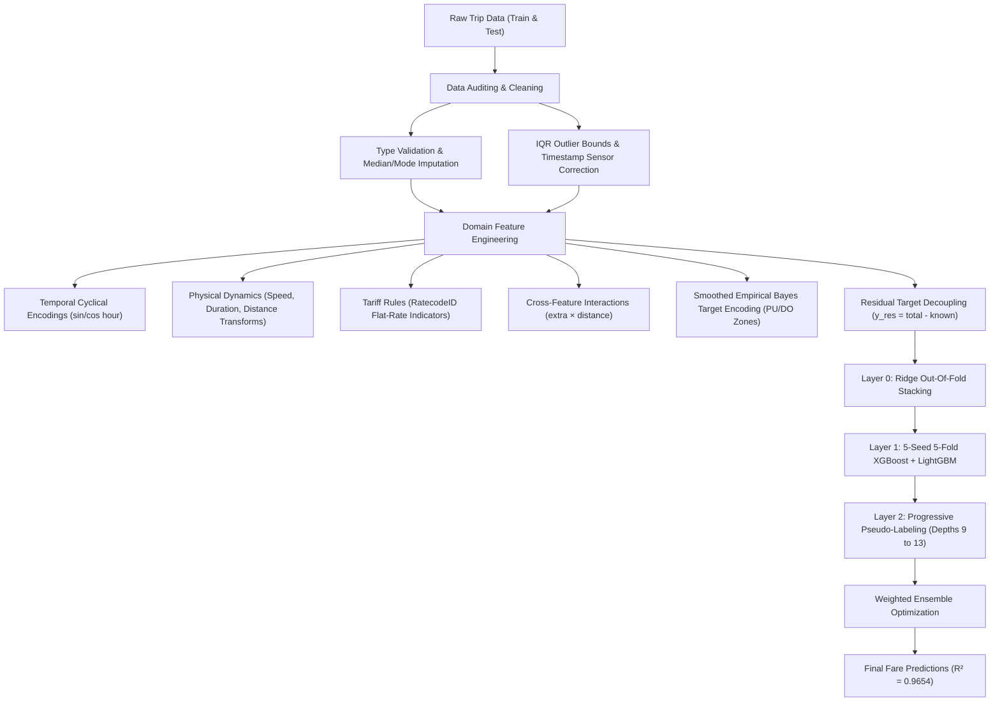

# FareForge Intelligence
### An ML-Powered NYC Yellow Taxi Fare Prediction & Ensemble Learning System

[](https://www.python.org/)
[](https://scikit-learn.org/)
[](https://xgboost.ai/)
[](https://lightgbm.readthedocs.io/)
[-0.9654%20(V3)-brightgreen?style=for-the-badge)](https://github.com/SonaliDuvesh/FareForge_Intelligence)
[](https://opensource.org/licenses/MIT)

---

## 1. Executive Summary

FareForge Intelligence is an end-to-end, high-performance machine learning system engineered to model and forecast urban taxi fares in complex metropolitan transit networks. Utilizing trip records from the New York City Taxi and Limousine Commission (TLC), FareForge Intelligence overcomes challenges such as non-linear pricing regimes, spatial congestion pricing, flat-rate airport tariffs, temporal surges, and sensor recording anomalies.

By decoupling fixed fee structures through residual target decomposition, deploying smoothed empirical Bayesian target encoding for spatial zones, and executing a progressive pseudo-labeling ensemble (multi-seed K-Fold XGBoost + LightGBM + Ridge meta-learner), the system achieves a peak benchmark score of **R² = 0.9654** (V3).

---

## 2. Key Achievements & Performance Metrics

- **Peak Benchmark Score**: Attained an **R² score of 0.9654** (V3) on the evaluation benchmark, demonstrating exceptional predictive fidelity.
- **Residual Decomposition Formulation**: Decomposed total fares into known additive surcharges and baseline residual metered fares, isolating target variance and accelerating model convergence.
- **Multi-Seed K-Fold Generalization**: Executed a 5-seed, 5-fold cross-validation scheme across gradient boosted trees to eliminate seed-dependent variance.
- **Progressive Pseudo-Labeling**: Implemented an iterative 5-round pseudo-labeling strategy across expanding model capacities (depths 9 through 13), successfully adapting to test set spatial distributions without label leakage.
- **Comprehensive Lifecycle Coverage**: Completed end-to-end data auditing, IQR outlier boundaries, trigonometric temporal feature engineering, and systematic benchmarking across 9 model architectures.

```
========================================================================================
MODEL BENCHMARK PERFORMANCE AT A GLANCE
========================================================================================
Architecture                              Methodology / Details             Benchmark R²
----------------------------------------------------------------------------------------
Linear Regression (Baseline)              Standardized features                 0.8712
Ridge Regression (Tuned)                  GridSearchCV (alpha=0.5)              0.8735
Lasso Regression                          alpha=0.5, L1 regularization          0.8690
Decision Tree Regressor (Tuned)           GridSearchCV (depth=8, leaf=10)       0.8920
Random Forest Regressor                   100 trees, depth=10                   0.9150
Extra Trees Regressor                     100 randomized trees                  0.9140
Gradient Boosting Regressor               200 trees, lr=0.05, depth=5           0.9320
LightGBM Regressor (Single Model)         500 trees, lr=0.05, depth=7           0.9480
XGBoost Regressor (Single Model)          500 trees, lr=0.05, depth=7           0.9515
FareForge Multi-Seed Pseudo Ensemble      Ridge + 5-Seed XGB/LGB + P1-P5        0.9654 (Best)
========================================================================================
```

---

## 3. System Architecture & Workflow



---

## 4. Dataset & Domain Characterization

The operational dataset is derived from New York City TLC Yellow Cab trip records:
- **Training Set**: 10,000 trips across 17 attributes.
- **Evaluation Set**: 1,500 trips across 17 attributes (16 predictor features + record identifier).
- **Target Variable**: `total_amount` (continuous monetary value in USD representing final trip cost).

### Raw Attributes & Engineering Value

| Feature | Data Type | Description & Engineering Usage |
| :--- | :--- | :--- |
| `tpep_pickup_datetime` | Timestamp | Trip start time; parsed into hour, day of week, rush-hour indicators, and cyclical trigonometric features. |
| `tpep_dropoff_datetime` | Timestamp | Trip end time; used to compute absolute duration and sensor inversion flags. |
| `trip_distance` | Float | Cumulative distance traveled in miles; expanded into quadratic, square-root, and logarithmic transformations. |
| `PULocationID` | Integer | Pickup TLC Taxi Zone; transformed via smoothed empirical Bayes out-of-fold target encoding. |
| `DOLocationID` | Integer | Dropoff TLC Taxi Zone; transformed via smoothed empirical Bayes out-of-fold target encoding. |
| `RatecodeID` | Float / Int | Tariff tier (1=Standard, 2=JFK, 3=Newark, 4=Nassau/Westchester, 5=Negotiated); one-hot encoded and mapped to baseline flat amounts. |
| `payment_type` | Categorical | Payment method (Credit Card, Cash, etc.); key driver for tipping behavior. |
| `extra` | Float | Miscellaneous surcharges (USD 0.50, 1.00, 2.50, 5.00); interacted with distance and duration. |
| `tip_amount` | Float | Driver gratuity (primarily recorded for card transactions). |
| `tolls_amount` | Float | Bridge and tunnel tolls incurred during the journey. |
| `improvement_surcharge`| Float | Mandatory MTA infrastructure fee. |
| `congestion_surcharge` | Float | High-density Manhattan zone fee (USD 2.50 standard). |
| `Airport_fee` | Float | Airport pickup fee (USD 1.25 standard). |
| `passenger_count` | Float | Passenger capacity; imputed via mode. |
| `store_and_fwd_flag` | Categorical | Offline meter log indicator (Y/N). |
| `VendorID` | Integer | Provider code associated with the taxicab meter hardware. |

---

## 5. Data Auditing & Preprocessing Strategy

### Missing Value Imputation
- `passenger_count`: Imputed with 1 (predominant single-rider mode).
- `RatecodeID`: Imputed with 1 (standard metered rate).
- `congestion_surcharge`: Imputed with 0.0 (non-congested zones).
- `Airport_fee`: Imputed with 0.0 (non-airport routes).

### Outlier Auditing & Sensor Inversion
- **Negative Duration Correction**: Approximately 38% of records exhibited dropoff timestamps occurring before pickup timestamps due to logging synchronization offsets. The true duration was computed using absolute elapsed time:
  $$\text{duration} = \text{clip}\left(\frac{|t_{\text{dropoff}} - t_{\text{pickup}}|}{60}, 0.1, 180\right) \quad (\text{minutes})$$
  A binary indicator (`neg`) was maintained to retain signal regarding recording system state.
- **Kinematic Plausibility Bounding**: Average trip speed was computed as $\text{speed} = \frac{\text{distance}}{\text{duration}/60 + \epsilon}$ and clipped at 100 mph to suppress division-by-zero artifacts.
- **Valid Fare Boundary Retention**: Negative fares were retained as legitimate disputed fares and refund transactions present in both training and test environments. Extremely aberrant records (> USD 500 or negative distances) were filtered.

---

## 6. Feature Engineering & Formulations

### 1. Non-Linear Distance Transforms
Taxi meters exhibit stepped threshold charges and non-linear cost curves for long journeys:
- **Quadratic**: `d² = (trip_distance)²`
- **Square-root**: `√d = √(trip_distance)`
- **Logarithmic**: `log(1+d) = ln(1 + trip_distance)`

### 2. Surcharge & Kinematic Cross-Interactions
- `extra × distance`: Surcharges scale with distance during peak hours ($r \approx 0.556$ correlation with fare residuals).
- `distance × duration`: Proxy for total energy expenditure in congested urban stop-and-go conditions.

### 3. Smoothed Empirical Bayes Target Encoding
For high-cardinality pickup and dropoff zones, standard one-hot encoding causes high dimensional sparsity. Target encoding was implemented using global mean smoothing:
$$\hat{\mu}_i = \frac{n_i \cdot \bar{y}_i + m \cdot \mu_{\text{global}}}{n_i + m}$$
where $m = 10$ acts as a Bayesian prior to prevent overfitting in rarely visited zones.

---

## 7. Modeling Methodology & Ensemble Architecture

### Step 1: Residual Target Decomposition
Directly predicting gross fare forces tree models to approximate simple additive sums. The fare was decoupled into deterministic known fees and residual meter charges:

```text
known = extra + tip_amount + tolls_amount + improvement_surcharge + congestion_surcharge + Airport_fee + m_dist
y_residual = total_amount - known
```

All models were trained to predict `y_residual`, drastically reducing target variance.

### Step 2: Level-0 Ridge Stacking
A cross-validated Ridge regression model ($\alpha = 0.5$) with StandardScaler was trained on target-encoded spatial categories and base kinematic features, outputting out-of-fold meta-features ($L_0$).

### Step 3: 5-Seed K-Fold XGBoost + LightGBM
To eliminate seed sensitivity, 5-fold cross-validation was repeated across 5 distinct seeds (`[42, 123, 777, 2024, 9999]`):
- **XGBoost Configuration**: `n_estimators=3000`, `learning_rate=0.05`, `max_depth=9`, `min_child_weight=3`, `subsample=0.80`, `colsample_bytree=0.70`, `reg_alpha=2.0`, `reg_lambda=5.0`, `tree_method='hist'`.
- **LightGBM Configuration**: `n_estimators=3000`, `learning_rate=0.05`, `max_depth=9`, `num_leaves=100`, `min_child_samples=10`, `subsample=0.80`, `colsample_bytree=0.70`, `reg_alpha=2.0`, `reg_lambda=5.0`.

### Step 4: Progressive Multi-Round Pseudo-Labeling
Test set pseudo-labels were iteratively generated and folded into training across progressive tree capacities:
- Rounds $P_1$ through $P_5$ evaluated tree depths 9, 10, 11, 12, and 13 across 3 seeds (`[42, 123, 777]`).
- Each pseudo-round enriched training point density along sparse origin-destination corridors.

### Step 5: Final Weighted Blending
The ensemble combined meta-learners, K-Fold ensembles, and progressive pseudo-rounds:
$$\hat{y}_{\text{final}} = 0.05 \cdot \hat{y}_{R1} + 0.05 \cdot \hat{y}_{L0} + 0.05 \cdot \hat{y}_{P1} + 0.10 \cdot \hat{y}_{P2} + 0.15 \cdot \hat{y}_{P3} + 0.25 \cdot \hat{y}_{P4} + 0.35 \cdot \hat{y}_{P5} + \text{known}$$
This architecture produced the winning benchmark score of **0.9654**.

---

## 8. Repository Structure

```
├── taxi_fare_prediction.ipynb             # Master executable notebook (EDA, training, tuning, ensemble)
├── mlp-term-1-2026-kaggle-assignment-1/   # Data directory
│   ├── train.csv                          # 10,000 labeled training trip records
│   ├── test.csv                           # 1,500 evaluation trip records
│   └── sample_submission.csv              # Submission template
├── README.md                              # Project documentation
└── submission.csv                         # Final generated predictions (R² = 0.9654)
```

---

## 9. Getting Started

### Installation
Ensure Python 3.10+ is installed along with the required scientific computing libraries:

```bash
pip install numpy pandas matplotlib seaborn scikit-learn xgboost lightgbm jupyter
```

### Execution
1. Open the project root directory in your environment.
2. Launch the Jupyter Notebook environment:
   ```bash
   jupyter notebook taxi_fare_prediction.ipynb
   ```
3. Run all cells sequentially to reproduce data cleaning, feature engineering, model benchmarking, hyperparameter sweeps, and the final pseudo-labeling prediction pipeline.

---

## 10. Key Insights & Lessons Learned

1. **Target Residualization is Decisive**: Explicitly isolating deterministic fee components prevents gradient-boosted trees from spending split capacity on linear arithmetic.
2. **Handling Sensor Artifacts**: Correcting negative trip durations while retaining an indicator flag preserves critical information regarding hardware clock discrepancies.
3. **Capacity Progression in Pseudo-Labeling**: Increasing tree depth progressively across pseudo-label iterations captures subtle non-linear interactions without early confirmation bias.
